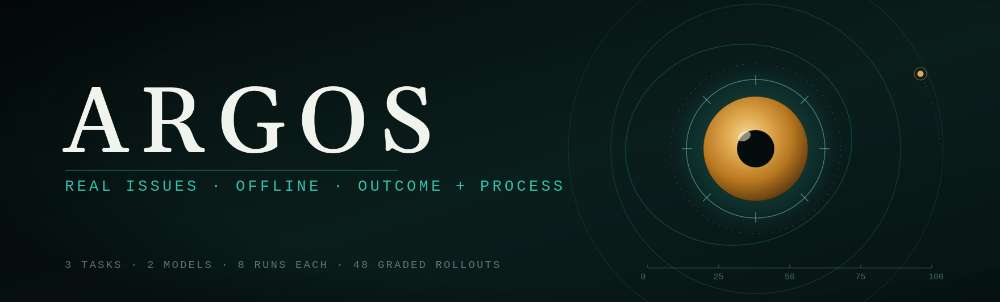
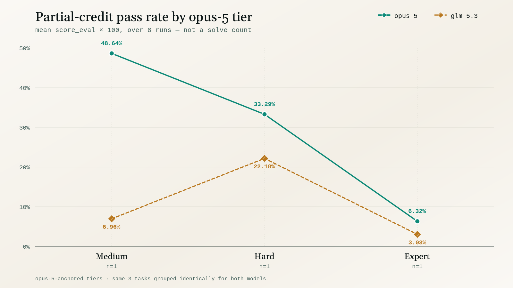
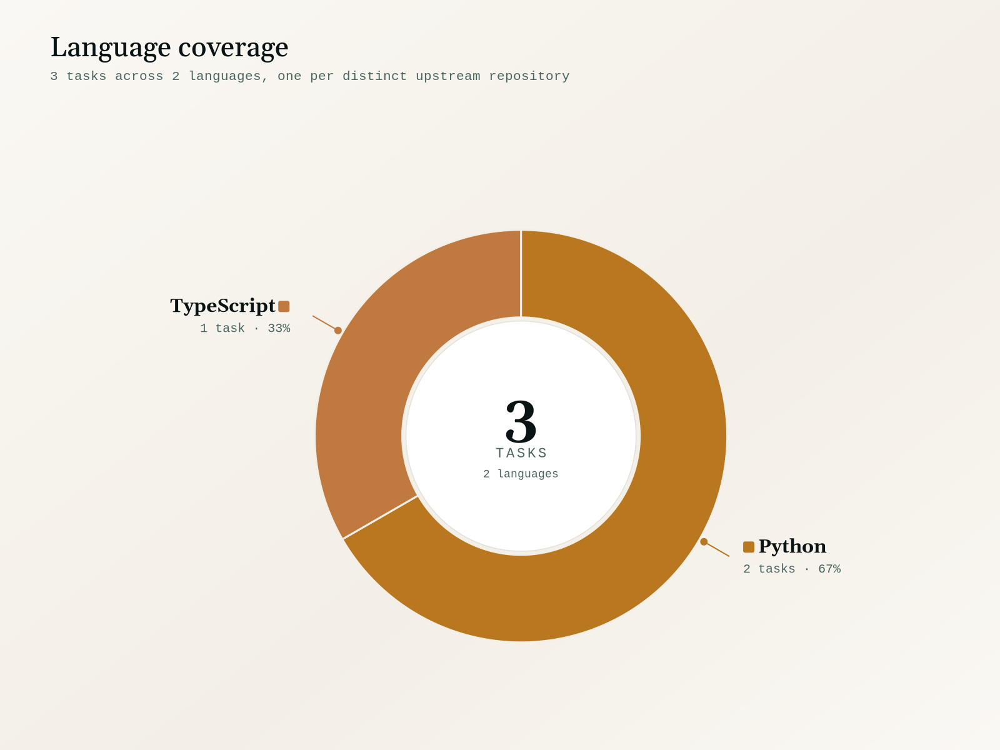
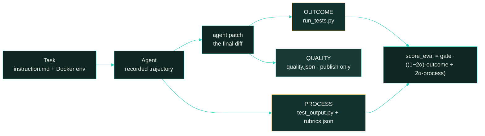

<p align="center">
  <picture>
    <source type="image/svg+xml" srcset="images/hero.svg">
    
  </picture>
</p>

<p align="center">
  <strong>Measuring agentic software-engineering capability on real, offline issue-resolution tasks.</strong>
</p>

<p align="center">
  <a href="#scoring-methodology"></a>
  <a href="#scoring-methodology"></a>
  <a href="#difficulty-tiers"></a>
</p>

<p align="center"><sub>
  <a href="#summary">Summary</a> · <a href="#repository-layout">Layout</a> · <a href="#difficulty-tiers">Tiers</a> · <a href="#results">Results</a> · <a href="#analysis">Analysis</a> · <a href="#coverage">Coverage</a> · <a href="#dataset-structure">Dataset</a> · <a href="#trajectory-structure">Trajectories</a> · <a href="#scoring-methodology">Scoring</a> · <a href="#reproduction">Reproduction</a> · <a href="#limitations">Limitations</a>
</sub></p>

# Argos: 3-Task Evaluation Sample

**Argos measures agentic software-engineering capability on real issue-resolution tasks, graded on
outcome, on how the work was done, and on the quality of the code produced.**

Each task takes a real merged pull request, pins the repository to the commit immediately before the
fix landed, and asks an agent to resolve the issue from scratch – offline, with no access to the
upstream solution. Tasks follow the
[Multi-SWE-bench](https://github.com/multi-swe-bench/multi-swe-bench) evaluation model, extended with
a **process-scoring layer** that grades how the agent worked and a **publish-only quality block** that
grades the diff it left behind.

This sample is narrow and deep: **3 tasks × 2 models × 8 runs = 48 graded rollouts.** The budget
goes on repetition rather than breadth, so difficulty is a measured rate over eight attempts rather
than a single observation. The three tasks are one per tier – one `medium`, one `hard`, one `expert` –
selected so that each occupies a different band of opus-5's measured pass rate.

**Not one of the 48 runs turned every required test green** – strict all-or-nothing scoring
(`score_binary`) is `0` on every rollout, so the true, full-task pass rate is **0% for both models**.
Throughout this document, **pass rate** means the **partial-credit pass rate**:

```
pass_rate(task, model) = 100 × mean( score_eval over that model's 8 runs on the task )
```

This is *not* pass@k (at-least-one-solve-in-k-tries) and it is *not* a count of solved tasks. It is a
continuous partial-credit rate, and it is the number every difficulty band in this document is cut on.

> This is a curated, quality-controlled sample of the Argos corpus, provided for evaluation. The
> dataset format, trajectory format and scoring are identical to the full corpus this sample is drawn
> from.

## Summary

| Property         | Value                                                                          |
| :--------------- | :----------------------------------------------------------------------------- |
| Tasks            | **3**, across 3 distinct upstream repositories                                  |
| Models           | `opus-5` (`anthropic/claude-opus-5`) and `glm-5.3`                              |
| Runs & grid      | 8 per model per task = **48 total**; full 2 × 8 grid, no gaps                   |
| Difficulty       | Calibrated on **opus-5**'s partial-credit pass rate, mean of 8 runs per task     |
| Judge            | `gpt-5.6-sol`, sole judge on all 48 runs                                        |
| Score            | `score_eval` ∈ [0, 1] – outcome-dominated, with process credit                  |
| Quality          | `score_quality` ∈ [0, 1] – 7 fixed items, **publish-only, never fed into `score_eval`** |
| Languages        | 2 (Python 2, TypeScript 1) – from `task.toml` `keywords[0]`                     |
| Provenance       | `[upstream_provenance]` on all 3 – origin, licence, base commit, PR, date       |

| metric | opus-5 | glm-5.3 |
|---|--:|--:|
| **partial-credit pass rate** (mean `score_eval`) | **29.42%** | 10.72% |
| full-task pass rate (`score_binary = 1`) | 0% (0/24) | 0% (0/24) |
| mean `outcome` | **0.251** | 0.056 |
| mean `score_quality` (publish-only) | 0.762 | **0.804** |
| runs with any outcome credit | **16 / 24** | 7 / 24 |
| mean agent cost / run | **$4.98** | $9.14 |
| mean episodes / run | **67** | 154 |

## Repository layout

```
argos-samples/
├── README.md                 # this document
├── LICENSE                   # MIT
├── images/
│   ├── hero.{svg,png}                     # cover (SVG source + rendered fallback)
│   ├── tasks_by_language-{light,dark}.{svg,png}
│   └── pass_rate_by_tier-{light,dark}.{svg,png}
└── <uuid>/                   # one self-contained directory per task (3)
    ├── task.toml, instruction.md, environment/, solution/, tests/
    └── trajectories/
        ├── opus-5/run_1 … run_8
        └── glm-5.3/run_1 … run_8
```

`pass_rate_by_tier-*` groups both models on the **same** opus-5-anchored tiers used everywhere else in
this document (see [Difficulty tiers](#difficulty-tiers) and [Results](#results)) – there is no
separate per-model grouping anywhere in this README. Each chart ships as an editable `.svg` source and
a rasterized `.png` fallback. `scripts/generate_charts.py` generates the four `.svg` files from the
same hardcoded, README-sourced figures (see the script's inline data table and the
[Reproduction](#reproduction) section for how those figures are derived from the shipped `result.json`
files); the `.png` fallbacks are rasterized exports of those SVGs, not produced by the script itself.

## Difficulty tiers

A tier is a **band on opus-5's measured pass rate** – the mean `score_eval` over opus-5's eight runs
on a task. Bands use exclusive upper endpoints:

| tier | opus-5 partial-credit pass rate (100 × mean `score_eval`) |
|---|---|
| `trivial` | ≥ 87.5% |
| `easy` | [50%, 87.5%) |
| `medium` | [37.5%, 50%) |
| `hard` | [25%, 37.5%) |
| `expert` | < 25% |

| tier | opus-5 tasks |
|---|--:|
| `medium` | 1 |
| `hard` | 1 |
| `expert` | 1 |
| `easy` | 0 |
| `trivial` | 0 |

The sample is deliberately one task per occupied band: no task lands in `trivial` or `easy`. Rebanding
all 3 `difficulty` labels from the shipped scores reproduces all 3 exactly – see
[Reproduction](#reproduction).

`difficulty` is the only difficulty label `task.toml` ships, and **this document uses it as the
single calibration axis**: every tier below groups the same three tasks the same way for both models, so
a tier is directly comparable across models rather than being redefined per model.

## Results

### Partial-credit pass rate by opus-5 tier

Both models are scored against the **same** task groups (the opus-5 bands above); only the numbers
inside each band differ per model. With one task per tier, each band below is a single task's eight
runs, not an average over several tasks. All pass-rate figures are the partial-credit rate defined
above (mean `score_eval` × 100), not a solve count.

| tier | n | opus-5 partial-credit pass rate | opus-5 `outcome` | opus-5 cost/run | glm-5.3 partial-credit pass rate | glm-5.3 `outcome` | glm-5.3 cost/run |
|---|--:|--:|--:|--:|--:|--:|--:|
| `medium` | 1 | **48.64%** | 45.75% | $6.13 | 6.96% | 0.00% | $19.97 |
| `hard` | 1 | **33.29%** | 29.62% | $5.87 | 22.18% | 16.88% | $3.90 |
| `expert` | 1 | **6.32%** | 0.00% | $2.94 | 3.03% | 0.00% | $3.55 |

<picture>
  <source media="(prefers-color-scheme: dark)" srcset="images/pass_rate_by_tier-dark.png">
  <source media="(prefers-color-scheme: light)" srcset="images/pass_rate_by_tier-light.png">
  
</picture>

opus-5's pass rate falls monotonically from `medium` to `expert`, which is what banding on its own
measured rate means – a tier *is* a band on this number. glm-5.3 does **not** fall monotonically: it
scores 6.96% on the `medium` task and 22.18% on the `hard` one, so the ordering that holds for opus-5
inverts for the other model between those two bands. Because the tiers are defined from opus-5's own 8
runs on these tasks and then reused to group glm-5.3's runs on the identical tasks, the comparison is
descriptive, not an independently validated difficulty scale: it tells you how the two models compare
on task groups opus-5's own results define, not how either model would be graded against a difficulty
measure derived from other data.

`outcome` is the pure test-transition channel; `score_eval` (the partial-credit pass rate) composes it
with process credit at weight 2α. α is `0.05` on all 48 runs, so `score_eval` is 90% outcome and 10%
process wherever outcome is non-zero. In the `medium` and `hard` bands the two columns track closely.
They separate completely in `expert`: outcome reads exactly `0.000` on all 8 opus-5 runs **and** all 8
glm-5.3 runs of `DTStack/molecule#641`, so every point either model scores in that band is process
credit. That is also where the two models separate most cleanly on process – opus-5 lands in
`[55.2%, 67.8%]` and glm-5.3 in `[27.5%, 35.0%]`, two non-overlapping ranges.

Cost does not track difficulty for either model. opus-5's per-run cost *falls* as the tier hardens
($6.13 → $5.87 → $2.94), and glm-5.3's sample maximum is on the `medium` task ($19.97), more than five
times its `expert` figure ($3.55) – it spends the most on the one task where it never scores any
outcome credit at all. Across the whole sample, 48 runs consumed **$338.90**, 0.48 B input tokens and
4.29 M output tokens.

## Analysis

**Eight runs reduce single-attempt noise, without giving a formal uncertainty estimate.** Averaging
eight attempts means a task's mean is not the outcome of one lucky or unlucky rollout, and the
difficulty label re-derives exactly from the shipped bytes rather than being asserted in advance – all
3 `difficulty` labels reproduce exactly (see [Reproduction](#reproduction)). With n=8 per task this
document does not compute a confidence interval or variance around any per-task mean; "measured" here
means "the recorded mean of 8 attempts", not a statistically bounded estimate. With one task per tier,
a band and a task are the same thing here, so no per-tier figure averages away a disagreement between
tasks.

**On this sample, opus-5 shows more capability per dollar.** It leads on pass rate (29.42% vs 10.72%)
while spending less per run ($4.98 vs $9.14) and using fewer episodes (67 vs 154). Most of that gap is
one task: on `secdev/scapy#3461` opus-5 earns outcome credit on 8 of 8 runs while glm-5.3 earns none on
any, and pays roughly three times as much per run to get there. This is a within-sample comparison
under one harness, one judge and these two specific model versions – it is not a general claim about
either model family.

**Three channels measure things the others cannot.** Outcome tracks the tests; process keeps runs
separable once outcome bottoms out at zero, which is exactly what happens on the `expert` task for both
models; quality reads the diff on its own terms – glm-5.3 edges opus-5 there (0.804 vs 0.762) despite
trailing on pass rate by nearly nineteen points. `score_quality` is publish-only, so a style judgement
can never move a capability number.

The separations hold because the grading resists gaming: agent and verifier both run with no network
egress, the oracle solution never enters the agent's environment, and 12 of the 46 rubric items carry
negative weight. This is directly checkable: the score-chain recomputation in
[Reproduction](#reproduction) reproduces `score_eval` for all 48 rollouts.

## Coverage

<picture>
  <source media="(prefers-color-scheme: dark)" srcset="images/tasks_by_language-dark.png">
  <source media="(prefers-color-scheme: light)" srcset="images/tasks_by_language-light.png">
  
</picture>

**3 distinct upstream org/repo pairs**, none repeated. Language, here and in the chart above, is read
from each task's `task.toml` `keywords[0]` (e.g. `["typescript", "issue-resolving", "molecule"]`); for
these three tasks `tests/config.json`'s `language` field agrees with it on all three. Oracle patches
span 68 to 1,922 changed lines (median 115) across 1–8 files and 1–9 hunks. The regression surface
(`p2p`) runs 89 to 4,242 tests, median 695; graded targets are small by comparison (`f2p` 2–6, and no
task in this sample uses `n2p` or `s2p`). Licences are GPL-2.0, MIT and NOASSERTION. `provenance_date`
spans 2022-01-27 to 2025-08-14.

### Full task list

Tier is opus-5-anchored throughout (see [Difficulty tiers](#difficulty-tiers)); the glm-5.3 column is
that model's score on the identical task, not a separately banded label. Both pass-rate columns are
partial-credit rates (mean `score_eval` × 100 over 8 runs), not solve counts.

| uuid | upstream | lang | f2p / n2p | opus-5 pass rate | glm-5.3 pass rate | tier |
|---|---|---|--:|--:|--:|---|
| `1213efa9` | [secdev/scapy#3461](https://github.com/secdev/scapy/pull/3461) | python | 3 / 0 | 48.64% | 6.96% | `medium` |
| `d7ecc24d` | [feldroy/air#246](https://github.com/feldroy/air/pull/246) | python | 6 / 0 | 33.29% | 22.18% | `hard` |
| `46ab8719` | [DTStack/molecule#641](https://github.com/DTStack/molecule/pull/641) | typescript | 2 / 0 | 6.32% | 3.03% | `expert` |

The three tasks are graded on 11 `f2p` transitions in total, behind 5,026 `p2p` regression tests.
`secdev__scapy-3461` carries the largest regression guard in the sample at 4,242 `p2p` tests against a
115-line, single-file oracle patch; `feldroy__air-246` carries the largest oracle patch at 1,922 lines
across 8 files, of which only `src/air/tags/models/svg.py` is graded source and the rest is
documentation.

## Dataset structure

```
<uuid>/
├── task.toml           # resources, network policy, difficulty, provenance
├── instruction.md      # the verbatim prompt handed to the agent
├── environment/
│   └── Dockerfile      # reproducible container the agent solves inside
├── solution/
│   ├── fix.patch       # oracle fix - the reference solution
│   ├── solve.sh        # applies + commits the oracle patch
│   └── TRUTH.md        # human-written ground truth (root cause, plan, pitfalls)
└── tests/
    ├── config.json     # instance metadata + expected test transitions
    ├── test.patch      # the tests that validate the fix
    ├── test.sh         # verifier entrypoint
    ├── run_tests.py    # Multi-SWE-bench outcome scorer
    ├── test_output.py  # generated process checks (pytest)
    ├── rubrics.json    # weighted rubric: gates, sites, judged criteria
    └── quality.json    # the fixed 7-item code-quality block
```

During a run the agent sees only the built repository, `instruction.md` and the environment.
`solution/` and `tests/` are used exclusively by the verifier and are never exposed to the agent.
Both the agent and the verifier run with `network_mode = "none"` on all 3 tasks, which closes the
path where either fetches the upstream PR diff and replays the oracle.

`task.toml` records provenance for every task – `canonical_repo`, `base_commit`, `pull_request`,
`event_timestamp`, `license` and `provenance_date`, the date the fix became public. `provenance_date`
is a contamination **screening reference** only – the best available proxy for a training-data freeze
date – not a guarantee that no contamination exists; see [Limitations](#limitations).

## Trajectory structure

```
<uuid>/trajectories/<model>/run_N/     # model ∈ {opus-5, glm-5.3}; N ∈ 1…8
├── result.json                  # trial record + verifier_result.scores
├── config.json                  # runtime trial config
├── agent/
│   ├── trajectory.json          # ATIF-v1.7 step log
│   ├── recording.cast           # asciinema v2 terminal capture
│   └── opus.pane / glm.pane     # tmux pane snapshot (short model name; run dir is opus-5 / glm-5.3)
├── artifacts/
│   ├── agent.patch              # the agent's final diff, as graded
│   └── manifest.json            # collected artifact index
└── verifier/
    ├── score.md                 # bare outcome score
    ├── final_score.md           # full score breakdown table
    ├── test-stdout.md           # raw test output
    ├── process.json             # process-channel detail (gates, probes, abstentions)
    ├── quality.json             # the quality judgment for this run
    ├── verdicts.jsonl           # per-item judge output for the rubric (R*) and gate (G*) items
    └── quality_verdicts.jsonl   # per-item judge output for the 7 quality items (Q1–Q7)
```

All 48 shipped runs contain exactly these seven `verifier/` files. `verdicts.jsonl` covers every
item in that task's `tests/rubrics.json` – both the judged rubric criteria `R1…Rn` and the gate
probes `G1…Gn` – so its line count tracks the rubric and varies by task: 14 lines for
`secdev__scapy-3461` and 16 for each of the other two. `quality_verdicts.jsonl` is always the same
seven lines `Q1…Q7`, one per item in `tests/quality.json`.

Replay any session with
`asciinema play <uuid>/trajectories/opus-5/run_1/agent/recording.cast`.

`verifier_result.scores` in `result.json` carries `score`, `score_continuous_v2`, `score_outcome`,
`score_deterministic`, `score_rubric`, `score_process`, `score_eval`, `score_rl` and `score_binary`;
the settings that produced them are in `verifier_result.assay` (`alpha`, `gate`, `judge`, `status`).
In every one of the 48 shipped runs, `score` and `score_continuous_v2` are numerically identical to
`score_outcome` – they mirror it rather than adding independent information here. `score_quality` is
deliberately **not** among these fields – it lives only in `verifier/quality.json`, under its own
top-level `score` key (e.g. `0.8571` for one sample run); that per-run `quality.json:score` is what is
averaged into the `score_quality` figures reported in this document.

Both `verdicts.jsonl` and `quality_verdicts.jsonl` hold one JSON object per judge call, keyed by
`item_id`, and use the same structured completion format:

```
[[RATIONALE: ...]]  [[SATISFIED: Yes|No]]  [[TRUNCATION_AFFECTED: Yes|No]]  [[EVIDENCE: ...]]
```

## Scoring methodology

Three channels are computed per run. Two compose into the headline score; the third is published
alongside it and never folded in.



### What "pass rate" means here

`score_binary` – 1 only when every required test flips – is **0 on all 48 runs**, so the true
full-task pass rate is **0% for both models**. The partial-credit pass rate used throughout this
document is:

```
pass_rate(task, model) = mean( score_eval over that model's 8 runs ) × 100
```

It is not pass@k and it is not a solve count. Aggregated over a tier it is the unweighted mean of the
per-task values – here a single task per tier – and it is the same number the difficulty bands are cut
on.

### Channel 1 – Outcome

`tests/test.sh` runs `run_tests.py`, which mirrors the Multi-SWE-bench flow: apply `test.patch`, run
the task's `test_cmd`, parse the log, and compare three recorded states (before the test patch, with
the patch and no fix, and with the agent's result). The target set is `f2p ∪ s2p ∪ n2p` – in this
sample that is `f2p` alone, 11 tests across the three tasks; `p2p` is the regression guard that must
not break. The best recall any run achieved was **0.667**, on `secdev__scapy-3461`.

### Channel 2 – Process

`rubrics.json` grades how the work was done, in three parts: **28 hard admissibility gates** per task
(84 in all – none tripped here), **1–3 probed source sites** per task (6 in all), and **14–16
judged items** per task (**46 in all**, of which **12 carry negative weight** – penalties for reward
hacking, dishonest reporting and scope creep).

| dimension | items | | dimension | items |
|---|--:|:--|---|--:|
| `issue_coverage` | 12 | | `adherence` | 7 |
| `verification` | 9 | | `maintainability` | 6 |
| `honesty` | 9 | | `scope_discipline` | 3 |

`process = (deterministic + rubric) / 2`, then
`score_eval = gate · ((1−2α)·outcome + 2α·process)`. α is `0.05` on all 48 runs, so outcome carries
90% of the composed score wherever outcome is non-zero. Of 736 per-item judge judgments, 28 abstained
(`TRUNCATION_AFFECTED: Yes`) and were dropped from the denominator rather than scored against
incomplete evidence. `gate` is **1 on all 48 runs**: no rollout was voided.

### Channel 3 – Quality (publish-only)

`tests/quality.json` is a **fixed block, identical across all 3 tasks** – seven Yes/No items, one
per dimension, equal weight, judged on `agent.patch` alone:

| id | dimension | satisfied across 48 runs |
|---|---|--:|
| `Q4` | `readability` | 48 / 48 – 100% |
| `Q6` | `idiomaticity` | 48 / 48 – 100% |
| `Q2` | `minimal_diff` | 40 / 48 – 83% |
| `Q1` | `conventions` | 38 / 48 – 79% |
| `Q7` | `dead_code` | 32 / 48 – 67% |
| `Q3` | `abstraction` | 30 / 48 – 62% |
| `Q5` | `naming` | 27 / 48 – 56% |

`score_quality` is the weighted pass fraction: **mean 0.783 across the sample** (median 0.857),
0.762 for opus-5 and 0.804 for glm-5.3, over 336 individual item judgments.

> **It is deliberately inert.** As the block's own description states: *"Publish-only:
> `score_quality` never enters `process`, `score_eval` or `score_rl`."* It is reported so the diff
> can be judged on its merits without letting a style opinion move a capability score.

## Reproduction

Every figure re-derives from the shipped bytes; no re-execution is needed. This script uses only the
Python standard library, asserts the run grid is complete (8 runs per task per model), re-derives the
opus-5 difficulty tiers, regroups glm-5.3 onto those same tiers, and checks both models' headline
pass rates:

```python
import json, glob, re, statistics
from collections import defaultdict

def band(x):
    for lo, name in [(.875, "trivial"), (.5, "easy"), (.375, "medium"), (.25, "hard"), (-1, "expert")]:
        if x >= lo:
            return name

tasks = []
for task_toml in sorted(glob.glob("*/task.toml")):
    task_dir = task_toml[: -len("task.toml")]
    raw = open(task_toml).read()
    shipped = re.search(r'^difficulty\s*=\s*"([^"]*)"', raw, re.M).group(1)

    per_model = {}
    for model in ("opus-5", "glm-5.3"):
        runs = sorted(glob.glob(f"{task_dir}trajectories/{model}/run_*/result.json"))
        assert len(runs) == 8, f"{task_dir}{model}: expected 8 runs, found {len(runs)}"
        scores = [json.load(open(r))["verifier_result"]["scores"]["score_eval"] for r in runs]
        per_model[model] = statistics.mean(scores)

    opus_band = band(per_model["opus-5"])
    assert opus_band == shipped, f"{task_dir}: shipped {shipped}, recomputed {opus_band}"
    tasks.append({"uuid": task_dir[:9], "opus": per_model["opus-5"], "glm": per_model["glm-5.3"],
                  "tier": opus_band})

assert len(tasks) == 3

# regroup glm-5.3 onto opus-5's tiers (same tasks, one calibration axis)
by_tier = defaultdict(list)
for t in tasks:
    by_tier[t["tier"]].append(t)

for tier in ("easy", "medium", "hard", "expert"):
    group = by_tier.get(tier, [])
    if not group:
        continue
    opus_rate = statistics.mean(t["opus"] for t in group) * 100
    glm_rate = statistics.mean(t["glm"] for t in group) * 100
    print(f"{tier:8s} n={len(group)}  opus-5={opus_rate:6.2f}%  glm-5.3={glm_rate:6.2f}%")

opus_overall = statistics.mean(t["opus"] for t in tasks) * 100
glm_overall = statistics.mean(t["glm"] for t in tasks) * 100
assert abs(opus_overall - 29.42) < 0.01, opus_overall
assert abs(glm_overall - 10.72) < 0.01, glm_overall
print(f"\noverall   opus-5={opus_overall:.2f}%  glm-5.3={glm_overall:.2f}%")

# the true, full-task pass rate is 0% for both models
for model in ("opus-5", "glm-5.3"):
    files = glob.glob(f"*/trajectories/{model}/run_*/result.json")
    solved = sum(1 for f in files if json.load(open(f))["verifier_result"]["scores"]["score_binary"] == 1)
    assert solved == 0, f"{model}: {solved} solved"
print("full-task solves: 0 / 24 for both models")
```

```
medium   n=1  opus-5= 48.64%  glm-5.3=  6.96%
hard     n=1  opus-5= 33.29%  glm-5.3= 22.18%
expert   n=1  opus-5=  6.32%  glm-5.3=  3.03%

overall   opus-5=29.42%  glm-5.3=10.72%
full-task solves: 0 / 24 for both models
```

**Verify the score chain** on every run. Scores ship rounded to 4 dp, so the comparison runs at
`1e-4`:

```bash
jq -r '.verifier_result as $v | $v.scores as $s | $v.assay as $a |
  (($s.score_deterministic + $s.score_rubric) / 2) as $p |
  ($a.gate * ((1 - 2*$a.alpha) * $s.score_outcome + 2*$a.alpha * $p)) as $e |
  if (($p - $s.score_process) | fabs) < 1e-4 and (($e - $s.score_eval) | fabs) < 1e-4
  then "ok" else "MISMATCH \(input_filename)" end' \
  */trajectories/*/run_*/result.json | sort | uniq -c
# -> 48 ok
```

**Confirm quality is inert** – `score_quality` appears in no `result.json`:

```bash
jq -e '.verifier_result.scores | keys | any(test("qual"))' \
  */trajectories/*/run_*/result.json 2>/dev/null | grep -c true
# -> 0
```

**Regenerate the charts** from the figures above:

```bash
python3 scripts/generate_charts.py
# -> wrote images/tasks_by_language-light.svg … images/pass_rate_by_tier-dark.svg
```

## License

MIT © 2026 Ethara.AI – see [LICENSE](LICENSE).

Upstream repository content referenced by these tasks remains under its own respective license.
