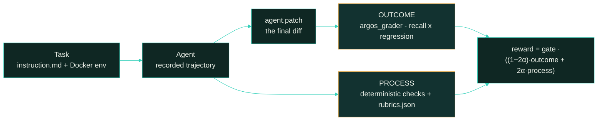

<p align="center">
  <picture>
    <source type="image/svg+xml" srcset="images/hero.svg">
    
  </picture>
</p>

<p align="center">
  <strong>Measuring agentic software-engineering capability on real, offline issue-resolution tasks.</strong>
</p>

<p align="center">
  <a href="#scoring-methodology"></a>
  <a href="#dataset-structure"></a>
  <a href="#difficulty-tiers"></a>
</p>

<p align="center"><sub>
  <a href="#summary">Summary</a> · <a href="#repository-layout">Layout</a> · <a href="#difficulty-tiers">Tiers</a> · <a href="#results">Results</a> · <a href="#analysis">Analysis</a> · <a href="#coverage">Coverage</a> · <a href="#dataset-structure">Dataset</a> · <a href="#trajectory-structure">Trajectories</a> · <a href="#scoring-methodology">Scoring</a> · <a href="#running-a-task">Running</a> · <a href="#reproduction">Reproduction</a> · <a href="#limitations">Limitations</a>
</sub></p>

# Argos: 3-Task Evaluation Sample

**Argos measures agentic software-engineering capability on real issue-resolution tasks, graded both
on outcome and on how the work was done.**

Each task takes a real merged pull request, pins the repository to the commit immediately before the
fix landed, and asks an agent to resolve the issue from scratch – offline, with no access to the
upstream solution. Tasks follow the
[Multi-SWE-bench](https://github.com/multi-swe-bench/multi-swe-bench) evaluation model, extended with
a **process-scoring layer** that grades how the agent worked.

This sample is narrow and deep: **3 tasks × 2 models × 8 runs = 48 graded rollouts.** The budget
goes on repetition rather than breadth, so each per-task score below is a mean over eight attempts
rather than a single observation.

**Exactly one of the 48 runs turned every required test green** – `score_binary` is `1` on
`secdev__scapy-3461` / `opus-5` / `run_5` and `0` on the other 47. The full-task pass rate is
therefore **4.17% for opus-5 and 0% for glm-5.3**. Everywhere else in this document, **pass rate**
means the **partial-credit pass rate**:

```
pass_rate(task, model) = 100 × mean( reward over that model's 8 runs on the task )
```

`reward` is the composed score in `result.json`. This is *not* pass@k (at-least-one-solve-in-k-tries)
and it is *not* a count of solved tasks. It is a continuous partial-credit rate.

> This is a curated, quality-controlled sample of the Argos corpus, provided for evaluation. The
> dataset format, trajectory format and scoring are identical to the full corpus this sample is drawn
> from.

## Summary

| Property       | Value                                                                                 |
| :------------- | :------------------------------------------------------------------------------------ |
| Tasks          | **3**, across 3 distinct upstream repositories                                  |
| Models         | `opus-5` (`anthropic/claude-opus-5`) and `glm-5.3` (`zai/glm-5.3`)            |
| Runs & grid    | 8 per model per task =**48 total**; full 2 × 8 grid, no gaps                   |
| Agent scaffold | `openhands-sdk` 1.49.3 on all 48; trajectories in `ATIF-v1.5`                     |
| Difficulty     | The`difficulty` label shipped in each `task.toml`                                 |
| Score          | `reward` ∈ [0, 1] – outcome-dominated, with process credit                        |
| Languages      | 2 (Python 2, Rust 1) – from`task.toml` `keywords[0]`                             |
| Provenance     | `[metadata.upstream_provenance]` on all 3 – origin, licence, base commit, PR, date |

| metric                                               |                 opus-5 |   glm-5.3 |
| ---------------------------------------------------- | ---------------------: | --------: |
| **partial-credit pass rate** (mean `reward`) |       **44.19%** |    23.26% |
| full-task pass rate (`score_binary = 1`)           | **4.17%** (1/24) | 0% (0/24) |
| mean`score_outcome`                                |        **0.429** |     0.206 |
| mean`score_process`                                |        **0.557** |     0.470 |
| runs with any outcome credit                         |      **23 / 24** |   14 / 24 |
| mean agent cost / run                                |        **$4.34** |     $4.47 |
| mean trajectory steps / run                          |           **64** |       165 |

## Repository layout

```
argos-samples/
├── README.md                 # this document
├── LICENSE                   # MIT
├── images/
│   ├── hero.{svg,png}                     # cover (SVG source + rendered fallback)
│   ├── tasks_by_language-{light,dark}.{svg,png}
│   └── pass_rate_by_tier-{light,dark}.{svg,png}
└── <uuid>/                   # one self-contained Harbor bundle per task (3)
    ├── task.toml, instruction.md, environment/, solution/, tests/
    └── trajectories/
        ├── opus-5/run_1 … run_8
        └── glm-5.3/run_1 … run_8
```

`pass_rate_by_tier-*` groups both models on the **same** shipped tiers used everywhere else in this
document (see [Difficulty tiers](#difficulty-tiers) and [Results](#results)) – there is no separate
per-model grouping anywhere in this README. Each chart ships as an editable `.svg` source and a
rasterized `.png` fallback, both committed artifacts, generated from the figures quoted in this
document. The chart generator is tooling, not sample data, and is kept outside this bundle.

## Difficulty tiers

`difficulty` is the only difficulty label `task.toml` ships, and **this document uses it as the
single grouping axis**: every tier below groups the same three tasks the same way for both models, so
a tier is directly comparable across models rather than being redefined per model.

The corpus convention cuts that label as a band on the reference model's measured pass rate; the
label is assigned upstream, and these bundles ship only its result. Bands use exclusive upper
endpoints:

| tier        | partial-credit pass rate (100 × mean`reward`) |
| ----------- | ------------------------------------------------ |
| `trivial` | ≥ 87.5%                                         |
| `easy`    | [50%, 87.5%)                                     |
| `medium`  | [37.5%, 50%)                                     |
| `hard`    | [25%, 37.5%)                                     |
| `expert`  | < 25%                                            |

Rebanding the three shipped labels from opus-5's measured rates in this sample reproduces **all three
exactly**:

| uuid         | shipped`difficulty` | opus-5 rate | reband   | agrees |
| ------------ | --------------------- | ----------: | -------- | :----: |
| `4056d683` | `easy`              |      51.07% | `easy` |   ✓   |
| `24d2a5dc` | `easy`              |      50.72% | `easy` |   ✓   |
| `276ad6ba` | `hard`              |      30.78% | `hard` |   ✓   |

Both `easy` tasks sit just above that band's 50% floor, so the agreement is real but not comfortable –
a swing of about one point on either would move them into `medium`.

| tier                                  | tasks |
| ------------------------------------- | ----: |
| `easy`                              |     2 |
| `hard`                              |     1 |
| `trivial` / `medium` / `expert` |     0 |

## Results

### Partial-credit pass rate by tier

Both models are scored against the **same** task groups (the shipped tiers above); only the numbers
inside each band differ per model. A tier's figure is the unweighted mean over the tasks in it – two
tasks for `easy`, one for `hard`.

| tier     | n | opus-5 pass rate | opus-5`outcome` | opus-5 cost/run | glm-5.3 pass rate | glm-5.3`outcome` | glm-5.3 cost/run |
| -------- | -: | ---------------: | ----------------: | --------------: | ----------------: | -----------------: | ---------------: |
| `easy` | 2 | **50.90%** |            50.00% |           $4.42 |            24.37% |             21.88% |            $5.93 |
| `hard` | 1 | **30.78%** |            28.75% |           $4.16 |            21.05% |             18.12% |            $1.55 |

<picture>
  <source media="(prefers-color-scheme: dark)" srcset="images/pass_rate_by_tier-dark.png">
  <source media="(prefers-color-scheme: light)" srcset="images/pass_rate_by_tier-light.png">
  
</picture>

Both models fall from `easy` to `hard`, so the shipped label order holds for both here. The gap
between them does not: opus-5 leads by 26.5 points on `easy` and by 9.7 on `hard`, almost entirely
because of one task – see the per-task table in [Coverage](#coverage).

`outcome` is the pure test-transition channel; `reward` composes it with process credit at weight 2α.
α is `0.05` on all 48 runs, so `reward` is 90% outcome and 10% process wherever outcome is non-zero.
The two columns track closely everywhere except one cell: outcome reads exactly `0.00` on all 8
**glm-5.3** runs of `secdev/scapy#3461`, so every point that model scores there is process credit.
Its `reward` spread inside that cell is narrow – `[0.0421, 0.0611]` – but non-zero, so the runs stay
ordered instead of collapsing into a tie at zero.

Cost does not track difficulty for either model. opus-5 spends most on the task it does best on
(`$5.21` on scapy, 51.07%) and least on gitoxide (`$3.63`, 50.72%). glm-5.3's sample maximum is
`$9.88`/run on scapy – five times its gitoxide figure – and it is the one task where it never scores
any outcome credit at all. Across the whole sample, 48 runs consumed **$211.28**, 22.3 hours of wall
clock, 0.47 B input tokens (99% of them cache reads) and 3.63 M output tokens over 5,493 agent steps.

## Analysis

**Eight runs reduce single-attempt noise, without giving a formal uncertainty estimate.** Averaging
eight attempts means a task's mean is not the outcome of one lucky or unlucky rollout. With n=8 per
task this document does not compute a confidence interval or variance around any per-task mean;
"measured" here means "the recorded mean of 8 attempts", not a statistically bounded estimate.

**opus-5 leads on every task, and one task supplies most of the margin.** It is ahead on all three
(51.07 vs 5.06, 30.78 vs 21.05, 50.72 vs 43.68) at comparable cost per run ($4.34 vs $4.47) and
roughly a third of the trajectory steps (64 vs 165). But 46 of the 60 points separating them come
from `secdev/scapy#3461` alone, where opus-5 earns outcome credit on 7 of 8 runs and glm-5.3 on none.
On gitoxide the two are within seven points. This is a within-sample comparison under one harness,
one agent scaffold and these two specific model versions – not a general claim about either family.

**The two channels disagree on gitoxide, and that is the point.** opus-5 scores 50.72% there on the
strength of outcome (0.500 on all 8 runs, identical recall every time), but its rubric score is the
lowest it records anywhere in the sample (0.466). Every one of the 16 gitoxide runs – both models –
trips guardrail `G7`, *"the run edits build output, vendored code or a lockfile in place of the source
those artifacts are produced from"*, a −3 item. The tests are satisfied; the way they were satisfied
is penalised. An outcome-only score would show none of this.

**The regression guard is not decorative.** `p2p` breakage is zero on 32 of 48 runs – and non-zero on
**all 16** runs of `feldroy/air#246`. opus-5 broke 2–3 of its 89 pass-to-pass tests every time
(regression factor 0.85–0.90); glm-5.3 broke 3–14 (factor 0.30–0.85), and one glm-5.3 run broke 10
while hitting no targets at all. Recall alone would have scored those runs identically to clean ones.

**One run broke the build outright.** `24d2a5dc` / `glm-5.3` / `run_5` is recorded as
`build_broken_by_patch`: its patch touched 114 files, the fix stage returned no test results, and the
outcome channel scored `0.0`. It was still graded rather than voided – `gate` is `1` – so it keeps its
process credit (`reward` 0.0477) and stays in every average in this document.

The separations hold because the grading resists gaming: the agent's allowlist reaches its model
endpoint and nothing else – these runs had no egress at all – the oracle solution never enters the
agent's environment, and 12 of the 46 rubric items carry negative weight. This is directly checkable: `score_process` and `reward` rebuild exactly from the
rubric weights in `tests/rubrics.json` and the per-item verdicts in `verifier/verdicts.jsonl`, for all
48 rollouts.

## Coverage

<picture>
  <source media="(prefers-color-scheme: dark)" srcset="images/tasks_by_language-dark.png">
  <source media="(prefers-color-scheme: light)" srcset="images/tasks_by_language-light.png">
  
</picture>

**3 distinct upstream org/repo pairs**, none repeated. Language, here and in the chart above, is read
from each task's `task.toml` `keywords[0]` (e.g. `["rust", "issue-resolving", "gitoxide"]`); for these
three tasks `tests/config.json`'s `language` field agrees with it on all three. Oracle patches span 35
to 2,129 changed lines (median 137) across 1–8 files and 1–9 hunks. The regression surface (`p2p`)
runs 89 to 4,242 tests, median 2,764; graded targets are small by comparison (`f2p` 3–6, and no task
in this sample uses `n2p` or `s2p`). Licences are GPL-2.0, MIT and Apache-2.0. `provenance_date` spans
2022-02-01 to 2025-09-24.

### Full task list

Tier is the shipped `task.toml` `difficulty` throughout (see [Difficulty tiers](#difficulty-tiers));
the glm-5.3 column is that model's score on the identical task, not a separately banded label. Both
pass-rate columns are partial-credit rates (mean `reward` × 100 over 8 runs), not solve counts.

| uuid         | upstream                                                                        | lang   | f2p / p2p | opus-5 pass rate | glm-5.3 pass rate | tier     |
| ------------ | ------------------------------------------------------------------------------- | ------ | --------: | ---------------: | ----------------: | -------- |
| `4056d683` | [secdev/scapy#3461](https://github.com/secdev/scapy/pull/3461)                   | python |  3 / 4242 | **51.07%** |             5.06% | `easy` |
| `24d2a5dc` | [GitoxideLabs/gitoxide#2191](https://github.com/GitoxideLabs/gitoxide/pull/2191) | rust   |  4 / 2764 | **50.72%** |            43.68% | `easy` |
| `276ad6ba` | [feldroy/air#246](https://github.com/feldroy/air/pull/246)                       | python |    6 / 89 | **30.78%** |            21.05% | `hard` |

The three tasks are graded on 13 `f2p` transitions in total, behind 7,095 `p2p` regression tests.
`secdev__scapy-3461` carries the largest regression guard in the sample at 4,242 `p2p` tests against a
137-line, single-file oracle patch; `feldroy__air-246` carries the largest oracle patch at 2,129 lines
across 8 files, of which only `src/air/tags/models/svg.py` is graded source and the rest is
documentation and `mkdocs.yml`. `GitoxideLabs__gitoxide-2191` is the smallest fix in the sample – 35
changed lines across 4 Rust files – and the only non-Python task.

## Dataset structure

```
<uuid>/
├── task.toml           # resources, network policy, difficulty, provenance, judge settings
├── instruction.md      # the verbatim prompt handed to the agent
├── environment/
│   └── Dockerfile      # reproducible container the agent solves inside
├── solution/
│   ├── fix.patch       # oracle fix - the reference solution
│   ├── solve.sh        # applies + commits the oracle patch
│   └── TRUTH.md        # human-written ground truth (root cause, plan, pitfalls)
└── tests/
    ├── config.json     # Multi-SWE-bench record + expected test transitions
    ├── instruction.md  # byte-identical copy of the task instruction, for rubric grounding
    ├── Dockerfile      # the separate verifier image
    ├── test.patch      # the tests that validate the fix
    ├── test.sh         # verifier entrypoint
    ├── rubrics.json    # weighted rubric: items, admissibility checks, probed sites
    └── argos_grader/   # vendored stdlib-only grader (11 modules + tools/ + its own README)
```

During a run the agent sees only the built repository, `instruction.md` and the environment.
`solution/` and `tests/` are used exclusively by the verifier and are never exposed to the agent.

**The agent reaches its model and nothing else; the verifier is open.** On all 3 tasks `[agent]` is
`network_mode = "allowlist"` with `allowed_hosts = ["api.anthropic.com", "api.z.ai"]` – the two model
endpoints and no other host, which closes the path where the agent fetches the upstream PR diff and
replays the oracle. The 48 recorded runs were made under a stricter setting still, an empty
allowlist, and the shipped logs show it: all 48 `agent/openhands_sdk.txt` files record the SDK
failing to resolve `raw.githubusercontent.com`. The verifier runs
`network_mode = "public"` (`network_profile = "dev-open"`) so that the shipped grader *can* reach a
rubric-judge endpoint if you configure one in `[verifier.env]`; the 48 recorded runs did not use it
(see [Scoring methodology](#scoring-methodology)).

`task.toml` records provenance for every task – `canonical_repo`, `base_commit`, `pull_request`,
`event_timestamp`, `license` and `provenance_date`, the date the fix became public. It also pins the
agent and verifier images by digest. `provenance_date` is a contamination **screening reference**
only – the best available proxy for a training-data freeze date – not a guarantee that no
contamination exists. The deterministic channel can show that no run *fetched* the upstream solution
(`C1-no-upstream-content-fetched` and `C2-no-oracle-path` pass on all 48), but it cannot show that a
model never memorised it.

## Trajectory structure

```
<uuid>/trajectories/<model>/run_N/     # model ∈ {opus-5, glm-5.3}; N ∈ 1…8
├── result.json                  # trial record + verifier_result.{scores,rewards,assay,diagnostics}
├── config.json                  # runtime trial config
├── lock.json                    # resolved task digest, agent, environment and verifier pins
├── agent/
│   ├── trajectory.json          # ATIF-v1.5 step log
│   └── openhands_sdk.txt        # raw scaffold stdout for the session
├── artifacts/
│   ├── agent.patch              # the agent's final diff, as collected
│   └── manifest.json            # collected artifact index
└── verifier/
    ├── reward.json              # {reward, score_outcome, score_binary, score_process, gate, alpha}
    ├── final_score.md           # full score breakdown table
    ├── metrics.json             # argos-metrics/1 - outcome, diagnostics, patch filter, control run
    ├── process.json             # argos-process/1 - deterministic checks, panel, composition
    ├── filtered.patch           # the patch that was actually applied, after test-path stripping
    └── verdicts.jsonl           # per-item verdict for the rubric (R*) and preamble (G*) items
```

All 48 shipped runs contain exactly these six `verifier/` files. `verdicts.jsonl` covers every item in
that task's `tests/rubrics.json` – both the requirement items `R1…Rn` and the preamble items `G1…G7`,
of which `G1`, `G2`, `G3` and `G7` are the negative-weight guardrails – so its line count tracks the
rubric and varies by task: 14 lines for `secdev__scapy-3461`, 16 for each of the other two.

`verifier_result.scores` in `result.json` carries `score`, `score_continuous_v2`, `score_binary`,
`reward`, `score_outcome` and `score_process`; `verifier_result.rewards` repeats the composed values
alongside `gate` and `alpha`, and the settings that produced them are in `verifier_result.assay`
(`alpha`, `gate`, `panel`, `status`). In every one of the 48 shipped runs `score` and
`score_continuous_v2` are numerically identical to `score_outcome` - they mirror it rather than adding
independent information here. `assay.status` is `reviewed` on all 48.

Each line of `verdicts.jsonl` is one JSON object per graded item, carrying the item, its verdict and
the justification behind it:

```json
{"item_id": "R1", "verdict": "yes", "justification": "..."}
```

## Scoring methodology

Two channels are computed per run and composed into a single headline score.



### How a run is scored

`tests/test.sh` runs the vendored `argos_grader` inside the verifier container and always exits 0 –
the trial's result is whichever file the grader wrote:

| # | stage                                                                                                                          | runs where                    | writes                                                                                                                         |
| - | ------------------------------------------------------------------------------------------------------------------------------ | ----------------------------- | ------------------------------------------------------------------------------------------------------------------------------ |
| 1 | **Outcome** – applies the agent's patch, runs the repository's own suite, scores the targets from `tests/config.json` | verifier container            | `reward.json`, `metrics.json`                                                                                              |
| 2 | **Deterministic** – rule checks on the trajectory and diff (fair play, run health, reached the changed files)           | verifier container            | `metrics.json` (`deterministic` block)                                                                                     |
| 3 | **Rubric** – each item in `tests/rubrics.json` is rated, 1 vote per item, and the reward is composed                  | verifier container*or* host | `verdicts.jsonl`, `final_score.md`, `process.json`, and the composed reward back into `reward.json` / `metrics.json` |

```
process = (deterministic + rubric) / 2
reward  = gate × ((1 − 2α) × outcome + 2α × process)      α ≤ 0.05
```

`gate` is `0` when a hard fair-play check fails – the run is **voided** and `reward` collapses to
zero regardless of its channels. On this sample no hard check failed, so `gate` is `1` on all 48 runs.
A grader crash or an unusable environment produces `invalid.json` instead of `reward.json`; neither
occurred here.

Stage 3 has two implementations, and **these runs used the host one**: `argos_grader.tools.score`
writes `process.json`, which the in-container path does not produce, and all 48 runs ship it. No run
carries a `judge_calls.jsonl`. The in-container path is what runs when you set `ARGOS_JUDGE_*` in
`[verifier.env]`; see [Running a task](#running-a-task).

Two run logs the grader can emit, `test-output.log` and `control-output.log`, are not shipped in this
bundle; `filtered.patch` (the patch actually applied, after test-path stripping) is.

### What "pass rate" means here

`score_binary` – 1 only when every target test flips **and** nothing in the preserve set breaks – is
`1` on exactly one of the 48 runs. The partial-credit pass rate used throughout this document is:

```
pass_rate(task, model) = mean( reward over that model's 8 runs ) × 100
```

It is not pass@k and it is not a solve count. Aggregated over a tier it is the unweighted mean of the
per-task values.

### Channel 1 – Outcome

`tests/test.sh` runs the vendored `argos_grader`, which mirrors the Multi-SWE-bench flow: run
`test_cmd` on the clean base tree to **measure** a baseline (rather than trusting the recorded one),
apply the agent patch with every test-owned path stripped out, run `test_cmd` again, and compare. The
target set is `f2p ∪ s2p ∪ n2p` – in this sample that is `f2p` alone, 13 tests across the three tasks;
`p2p` is the regression guard that must not break.

```
outcome = round( clamp( recall × regression_factor ), 2 )
recall            = |newly-passing targets| / |effective targets|
regression_factor = max(0, 1 − broken_p2p / max(20, min(|preserve set|, |targets|)))
```

The best recall any run achieved was **1.000**, on `secdev__scapy-3461`. `regression_factor` is `1.0`
on 32 runs and drops as low as `0.30` on `feldroy__air-246`. A pass-to-pass test that already fails in
the measured baseline leaves the preserve set and is reported as `environment_excluded_p2p` (27
network-dependent scapy tests, for example) rather than being charged to the agent. No run in the
sample skipped or disabled a target: `evasion_ratio` and `unknown_breaks_count` are `0` on all 48.
Outcome status is `scored` on 47 runs and `build_broken_by_patch` on one.

### Channel 2 – Process

`rubrics.json` grades how the work was done, in three parts: **28 declared admissibility and
discipline checks** per task (84 in all; 23–29 of them emit a verdict per run, the rest are not
applicable to these trajectories), **1–4 probed source sites** per task (7 in all), and **14–16
reviewed items** per task (**46 in all**, of which **12 carry negative weight** – guardrails against
reward hacking, dishonest reporting and scope creep).

| dimension          | items |  | dimension            | items |
| ------------------ | ----: | :- | -------------------- | ----: |
| `issue_coverage` |    13 |  | `adherence`        |     7 |
| `honesty`        |     9 |  | `maintainability`  |     6 |
| `verification`   |     8 |  | `scope_discipline` |     3 |

```
raw     = Σ(signed weight of satisfied items) / Σ(positive weights)
rubric  = α + (1 − α)·raw                      # floor-banded at α
det     = weighted pass fraction over non-abstaining soft checks
process = (det + rubric) / 2
reward  = gate · ((1 − 2α)·outcome + 2α·process)
```

α is `0.05` on all 48 runs, so outcome carries 90% of the composed score wherever outcome is non-zero.
Of 1,232 deterministic check verdicts, 210 abstained: they are recorded, but they neither gate the run
nor enter the soft-score denominator, so nothing is charged against absent evidence.
`B4-not-at-turn-ceiling`, `C1b-history-probe` and `C1c-third-party-fetch` abstain on all 48 by
construction; `B3-reached-finish` abstains on the 32 runs whose trajectory records no explicit finish
step. Across 736 reviewed item verdicts, 314 are `yes` and 422 `no`. A negative-weight guardrail was
marked satisfied – the penalty applied – in 17 runs: `G7` on **all 16** `GitoxideLabs__gitoxide-2191`
runs and `G2` on one `feldroy__air-246` run. `gate` is **1 on all 48 runs**, no run recorded a hard
failure, and no rubric item was dropped: no rollout was voided.

**On the rubric judge.** `[verifier.env]` ships `ARGOS_JUDGE_*` placeholders and the grader includes a
judge module, so the verifier can score rubric items with a model you configure. **The 48 recorded
runs did not use it** - no run carries a `judge_calls.jsonl`. See
[Re-judge a recorded run](#re-judge-a-recorded-run-with-your-own-model) to re-score them yourself.

## Running a task

Requires Harbor, Docker and Python 3.10+, plus pull access to the base images referenced in
`task.toml` and the two Dockerfiles (private registry
`426628337772.dkr.ecr.ap-south-1.amazonaws.com`).

**End to end** (agent + tests + deterministic + rubric), from inside a bundle folder:

```bash
harbor run -p . -a <agent> -m <model> --job-name <name> -o <out-dir> -y
```

**Grade one recorded patch** with `test.sh` alone. Without judge settings the grader behaves exactly
as it did for the recorded runs – outcome and deterministic checks only:

```bash
docker build -t verifier tests/
docker run --rm -v $PWD/logs:/logs verifier bash /tests/test.sh
# logs/artifacts/agent.patch = the patch, logs/agent/trajectory.json = the trajectory
```

### Re-judge a recorded run with your own model

```bash
PYTHONPATH=tests python3 -m argos_grader.tools.score trajectories/glm-5.3/run_1 --task . \
  --judge-model openai/<judge-model> --judge-base-url https://api.openai.com/v1 \
  --judge-api-key "$OPENAI_API_KEY" --votes 1
```

This **overwrites** that run's `verifier/verdicts.jsonl`, `judge_calls.jsonl`, `process.json`,
`final_score.md` and `reward.json`, replacing the shipped verdicts. Add `--no-write` to print
the result without changing files. Judge models must speak the OpenAI Responses API
(`openai/<model>`) or the Anthropic Messages API (`anthropic/<model>`).

Always pass `--task` (or `--pk task=`): `result.json` records the path the run was originally graded
from.

## License

MIT © 2026 Ethara.AI – see [LICENSE](LICENSE).

Upstream repository content referenced by these tasks remains under its own respective license.
